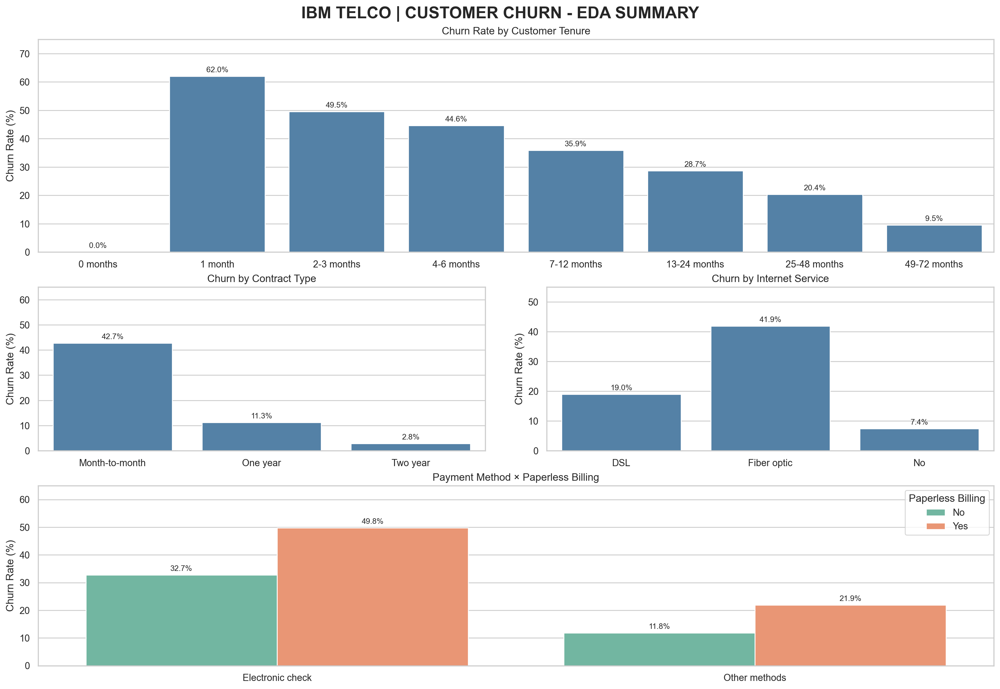

# Telco Customer Churn Prediction & Retention Prioritization

### An End-to-End Machine Learning Project

## 1. Project Overview

Customer churn is a significant concern for subscription-based businesses. Identifying customers at risk of leaving enables organizations to investigate potential retention opportunities and allocate resources more effectively.

This project develops a modular machine learning pipeline to predict customer churn and translate model outputs into actionable risk-based customer segments.

**Project objectives:**

- Identify patterns associated with customer churn through exploratory data analysis.
- Develop and compare supervised classification models.
- Improve the reliability of predicted churn probabilities through calibration.
- Segment customers into risk tiers for retention prioritization.
- Incorporate customer tenure, contract type, and monthly billing exposure into business analysis.
- Build a reusable inference pipeline supported by automated tests.

The emphasis is not solely on predictive performance, but also on the reliability, interpretability, and operational usefulness of model predictions.

---

## 2. Dataset

**Source:** IBM Telco Customer Churn dataset

The dataset contains 7,043 customer records, including information about customer demographics, subscribed services, contract details, tenure, monthly charges, and churn status.

The target variable is `Churn`, where:

- `1`: Customer churned
- `0`: Customer did not churn

Approximately 26.5% of customers churned, creating a moderately imbalanced classification problem.

The data was divided into stratified training (70%), validation (15%), and test (15%) partitions.

### Data preprocessing

- Converted the `TotalCharges` field from string to numeric.
- Handled blank `TotalCharges` entries using the domain-informed approximation `tenure × MonthlyCharges`.
- Standardized numerical features.
- One-hot encoded categorical features.
- Used scikit-learn pipelines to apply preprocessing consistently during model fitting and prediction.

The TotalCharges imputation is an approximation rather than an exact reconstruction of historical billing.

---

## 3. Exploratory Data Analysis

EDA identified several associations with customer churn.

**Key findings:**

- Customers with shorter tenure exhibited higher observed churn rates.
- Month-to-month contract holders had substantially higher churn rates than customers on one-year or two-year contracts.
- Contract type and tenure were related, motivating further analysis of their joint distribution.

These findings informed subsequent customer segmentation and business recommendations.

The relationships are observational and should not be interpreted as causal effects.


[View EDA profiling report](notebooks/telco_eda.html)

---

## 4. Model Development and Selection

Multiple classification approaches were explored, including:

- Logistic Regression
- Random Forest
- Gradient Boosting
- CatBoost
- Support Vector Machines

Class weighting, hyperparameter tuning with Optuna, feature engineering, and decision-threshold adjustments were also investigated.

### Why Logistic Regression?

A class-weighted Logistic Regression was selected because it offered a strong balance of churn recall, discrimination, interpretability, and implementation simplicity.

More complex models did not demonstrate sufficiently meaningful improvements to justify their additional complexity.

Hyperparameter tuning and engineered features were evaluated but did not produce compelling improvements over the selected baseline.

---

## 5. Probability Calibration

### Why calibration was necessary

Class weighting improved the model's ability to identify churners but also affected the reliability of its predicted probabilities.

Since the business objective involved grouping customers according to estimated churn risk, reliable probability estimates were particularly important.

Two calibration methods were evaluated:

- Sigmoid calibration
- Isotonic calibration

Both improved probabilistic prediction quality. Sigmoid calibration was selected because it achieved comparable performance using a simpler parametric mapping.

### Calibration evaluation

Calibration and probability quality were assessed using:

- Reliability diagrams
- Brier score
- Log Loss
- Expected Calibration Error (ECE)
- ROC-AUC to monitor discrimination

A custom ECE function was implemented to measure customer-weighted calibration gaps across probability bins.

---

## 6. Final Model Performance

The finalized sigmoid-calibrated Logistic Regression was evaluated on the untouched test set.

| Metric                            | Test result |
| --------------------------------- | ----------: |
| ROC-AUC                           |       0.846 |
| Precision (Churn, threshold 0.50) |       0.661 |
| Recall (Churn, threshold 0.50)    |       0.534 |
| F1 Score (Churn)                  |       0.591 |
| Brier Score                       |      0.1357 |
| Log Loss                          |      ≈0.416 |
| Expected Calibration Error        |      ≈0.020 |

### Comparison with naive baseline

A naive baseline assigning every customer the training-set churn prevalence achieved a test Brier score of approximately **0.1952**.

The calibrated Logistic Regression achieved **0.1357**, a reduction of approximately **30.5% in Brier score**.

Validation and test results were broadly consistent, supporting the model's ability to generalize to unseen customer records.

The results also demonstrate an important distinction: strong ranking discrimination does not necessarily imply high recall at every classification threshold.

---

## 7. Risk Stratification

Rather than relying exclusively on one binary classification threshold, calibrated churn probabilities were used to create four customer risk tiers.

| Risk tier      | Predicted churn probability |
| -------------- | --------------------------- |
| Low Risk       | Below 30%                   |
| Medium Risk    | 30% to below 50%            |
| High Risk      | 50% to below 70%            |
| Very High Risk | 70% and above               |

These thresholds are provisional business-oriented boundaries, selected through validation analysis rather than an optimization of intervention return on investment.

### Test-set business findings

- The High and Very High Risk tiers together contained approximately **21.5% of customers**.
- These tiers captured approximately **53.4% of actual churners**.
- Observed churn rates increased consistently from Low Risk to Very High Risk.
- The test-set segmentation showed similar churn concentration to the validation results.

This demonstrates how risk stratification can help prioritize a smaller group of customers for closer review.

---

## 8. Customer Context and Retention Strategy

The risk tiers were examined alongside tenure and contract type.

Validation analysis found that all customers in the combined High and Very High Risk groups held month-to-month contracts, with a substantial concentration among customers with shorter tenure.

A provisional retention framework was developed:

| Priority | Customer segment             | Proposed approach                                    |
| -------- | ---------------------------- | ---------------------------------------------------- |
| P1       | Very High Risk               | Prioritize personalized retention review             |
| P2       | High Risk, tenure ≤12 months | Investigate early customer experience and onboarding |
| P3       | High Risk, tenure >12 months | Review ongoing service experience                    |
| P4       | Medium Risk                  | Consider lower-cost engagement                       |
| Routine  | Low Risk                     | Maintain standard customer engagement                |

These are proposed interventions, not experimentally validated retention policies.

### Incorporating monthly billing exposure

Monthly charges were evaluated as an additional prioritization consideration.

A risk-weighted monthly billing proxy was calculated:

`Predicted Churn Probability × MonthlyCharges`

Under an illustrative retention capacity of 100 customers:

| Ranking strategy              | Actual churners identified |
| ----------------------------- | -------------------------: |
| Churn probability             |                         83 |
| Risk-weighted monthly billing |                         76 |

The two approaches selected 71 customers in common.

Probability-based ranking was retained as the primary strategy because it identified more actual churners under the project's primary objective.

Monthly charges were retained as a secondary consideration for operational prioritization.

Importantly, risk-weighted billing is not equivalent to expected recoverable revenue, customer profitability, or customer lifetime value.

---

## 9. Project Architecture

The project separates data preparation, model experimentation, evaluation, risk stratification, and inference into reusable components.

```text
telco_churn_pipeline/
├── config.py
├── pipeline.py
├── requirements.txt
├── models/
│   └── calibrated_lr.joblib
├── notebooks/
|   ├── 01_eda.ipynb
|   ├── 02_model_experiments.ipynb
|   ├── eda_summary_dashboard.png
|   └── telco_eda.html
├── steps/
│   ├── data_ingestion.py
│   ├── preprocessing.py
│   ├── feature_engineering.py
│   ├── model_training.py
│   ├── evaluation.py
│   └── risk_stratification.py
└── tests/
    ├── test_evaluation.py
    ├── test_preprocessing.py
    ├── test_risk_stratification.py
    └── test_pipeline_integration.py
```

The fitted model artifact includes the preprocessing and calibrated classification workflow.

### Inference

The `predict_churn()` function in `pipeline.py` accepts raw customer features and returns:

- Calibrated churn probability
- Assigned risk tier

Example:

```python
from pipeline import predict_churn

# customer_data is a pandas DataFrame
# containing the 19 required raw input features.

results = predict_churn(customer_data)
print(results)
```

---

## 10. Automated Testing

The project includes unit and integration tests using `pytest`.

Test coverage includes:

- Numeric conversion and imputation in the custom `TotalChargesCleaner`.
- Known-value and empty-bin ECE calculations.
- Risk-tier assignment and threshold boundary conditions.
- Invalid probability inputs.
- End-to-end predictions through the saved calibrated model.

**Test suite result: 30 tests passed.**

To execute the tests:

```bash
python -m pytest -v
```

The integration test confirms that a synthetic customer record can pass through the saved preprocessing and calibrated prediction pipeline and receive a valid risk tier.

---

## 11. Reproducibility

The project was developed in Python 3.13 using a virtual environment.

The frozen `requirements.txt` contains the package versions used in the working development environment.

### Setup

Clone the repository and navigate to the project directory.

Create a virtual environment:

```bash
python3.13.5 -m venv .venv
```

Activate it on macOS/Linux:

```bash
source .venv/bin/activate
```

Install dependencies:

```bash
python -m pip install -r requirements.txt
```

Run automated tests:

```bash
python -m pytest -v
```

Run predictions using the saved model and `predict_churn()`.

Serialized scikit-learn models can be sensitive to library-version changes. The supplied frozen requirements help reproduce the development environment.

---

## 12. Limitations and Future Improvements

- The dataset is historical and may not represent current telecom customer behavior.
- Observed relationships between churn and customer characteristics do not establish causality.
- The dataset does not include retention campaign outcomes, intervention costs, or customer profitability.
- The proposed retention actions require business validation before deployment.
- Global calibration metrics can conceal larger errors within particular customer subgroups.
- Risk thresholds were selected for exploratory operational analysis and are not proven financially optimal.

Potential extensions include customer segmentation through unsupervised learning, retention intervention experiments, and performance monitoring on newer customer data.

---

## 13. Conclusion

This project demonstrates an end-to-end approach to churn modelling, from exploratory analysis and model development to probability calibration, customer risk stratification, and reusable inference.

The final calibrated Logistic Regression achieved a test ROC-AUC of **0.846** and a Brier score of **0.1357**, outperforming a naive probability baseline.

More importantly, the resulting risk segmentation identified approximately **53.4% of observed churners within 21.5% of test customers**, offering a practical foundation for capacity-aware retention prioritization.

The project illustrates how machine learning predictions can support business decisions while clearly distinguishing predictive risk from the effectiveness of potential interventions.
